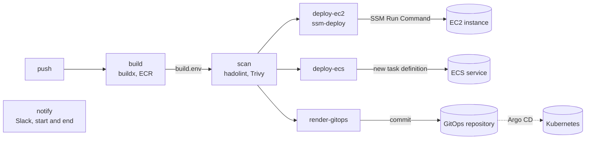

# aws-delivery-templates

[](https://github.com/QwertyUser17/aws-delivery-templates/actions/workflows/ci.yml)

## What it is and who it is for

This is my approach to delivering containers to AWS. It grew out of real projects and has run in production; this repository builds it again from scratch, in a better form - new code, new structure, and things the earlier version didn't have: rollback by rename, OIDC instead of keys, tests.

CI templates that build a Docker image, push it to ECR, scan it and deploy it to AWS. Most of it is GitHub Actions reusable workflows. There is also one GitLab CI template, for the EC2 deploy.

It's for a small team with a few services on AWS, where every repository needs almost the same pipeline. Only the last step depends on where the service runs: one EC2 instance, ECS, or Kubernetes with Argo CD. The interesting part is "Decisions and why", most of all the EC2 deploy.

## Architecture



The stages pass data in one file, `build.env`: the image with its digest, the build number, the commit and the run URL. All values are single-quoted, so `. build.env` works in sh, dash and bash. The GitLab template uses the same file and the same deploy tool.

AWS access is OIDC everywhere. There are no AWS keys in GitHub or GitLab.

## Decisions and why

### Workflows only pass inputs
A workflow reads its inputs, logs in to AWS and runs a bash script from `scripts/` or `tools/`. All the logic is in the scripts, and you can run them on a laptop. The EC2 deploy also has a few bats tests with a fake docker.

### EC2 deploy through SSM
[ssm-deploy](tools/ssm-deploy/README.md) sends the deploy script to the instance with SSM Run Command. The instance needs no SSH and no open ports, only the SSM agent and a role. The output goes to CloudWatch Logs and is also printed in the job log.

### The script used to live in a JSON string
My first SSM deploy had the whole instance script inside the JSON of `send-command --parameters`. Quotes were escaped by hand, three levels deep (`\\\"`). A double quote in an env value ended the JSON string, and `send-command` failed. So I added a check that didn't allow double quotes at all.

Later I rewrote it with a heredoc: the values first, as single-quoted variables, then the script as it is, and the JSON is made once at the end. Here it's the same idea, but `remote.sh` is a normal file with its own tests, and `jq` makes the JSON.

### run-args are quoted too
Every word of `run-args` reaches the instance in single quotes. `--memory 256m; touch /tmp/x` becomes four strange docker arguments, and docker refuses them. The first version of this repo didn't do this, so a `;` there would run as root on the instance.

### The old container waits until the new one is healthy
The running container is stopped and renamed to `<name>-previous`. If the new one fails the health check, the old one gets its name back and starts again with its own env and ports.

Nothing is touched before the pull works. An earlier version had a bug here: the pull output went through a `grep` that removed the progress lines, with `|| true` after it. So a failed pull didn't stop the deploy. The script went on, removed the running container and failed only at `docker run`, so a wrong tag would take the service down.

### The health check sees restarts
A container that restarts every few seconds still shows "Up" in `docker ps`. So the check wants several good results in a row, and it also compares `StartedAt` between checks. If the start time changed, the container restarted and the deploy fails.

### Build numbers only grow
Tags are the run number plus the branch type: `42` for main, `42-rc`, `42-feature`, `42-unknown` and so on. The run number only grows. render-gitops uses it to skip an old pipeline that finishes after a newer one, and the EC2 cleanup uses it to keep the newest images.

### Kubernetes deploy is a commit
render-gitops never talks to the cluster. It changes the image in one file of the GitOps repository, pushes a commit, and Argo CD does the rest. If another pipeline pushed first, it fetches the new head, checks the order again and tries again.

### ECS rolls back from what runs
deploy-ecs makes the new task definition from the revision the service runs now, not from the latest one. After a failed deploy, the latest revision is the broken one.

### Everyone uses main
There are no version tags. All projects call the templates at `@main`. A fix reaches every project with its next pipeline. A bug does too, so every change goes through the CI of this repo first: shellcheck, the bats tests, actionlint and the schema checks.

## Things I'm not sure about

- ssm-deploy has a few seconds of downtime, from stopping the old container until the new one listens. For internal services that's fine. For a public site I would add a proxy (see the last section).
- The health check gives up after `HEALTH_PASSES + 20` checks, about two minutes with the defaults. A slow JVM service may need more, and you have to set it by hand.

## How to use

The fastest way to try it is the EC2 example:

1. Create the instance, the ECR repository, the log group and the CI role with OIDC:

   ```bash
   cd infra
   cp terraform.tfvars.example terraform.tfvars   # set your owner/repo
   terraform init
   terraform apply
   ```

2. In your repository, set the variables `AWS_REGION`, `AWS_ROLE_ARN` and `EC2_INSTANCE_ID` from the Terraform outputs, and the secret `SLACK_WEBHOOK_URL`.

3. Copy the Dockerfile and `index.html` from [`examples/app`](examples/app) and [`examples/ec2/.github/workflows/deliver.yml`](examples/ec2/.github/workflows/deliver.yml) into your repository and push to main.

The security group has no inbound rules. To open the page, forward a port through SSM:

```bash
aws ssm start-session --target <instance-id> --document-name AWS-StartPortForwardingSession \
  --parameters '{"portNumber":["80"],"localPortNumber":["8080"]}'
```

The ECS and GitOps pipelines are in [examples](examples), the GitLab one is in [examples/gitlab-ec2](examples/gitlab-ec2/.gitlab-ci.yml). Every template has a page in [docs](docs) with its inputs and what to check after the first run.

## What I would add in production

- A small proxy on the instance, like Caddy or kamal-proxy. ssm-deploy would start the new container next to the old one and switch traffic after the health check, with no downtime.
- Image signing with cosign in build, and a signature check before the deploy.
- Container secrets from Secrets Manager, read on the instance. Now `CONTAINER_ENV` goes through SSM, and anyone who can read the command history can read it.
- Continuous scanning in the registry (ECR enhanced scanning), because new CVEs appear for images that are already deployed.
